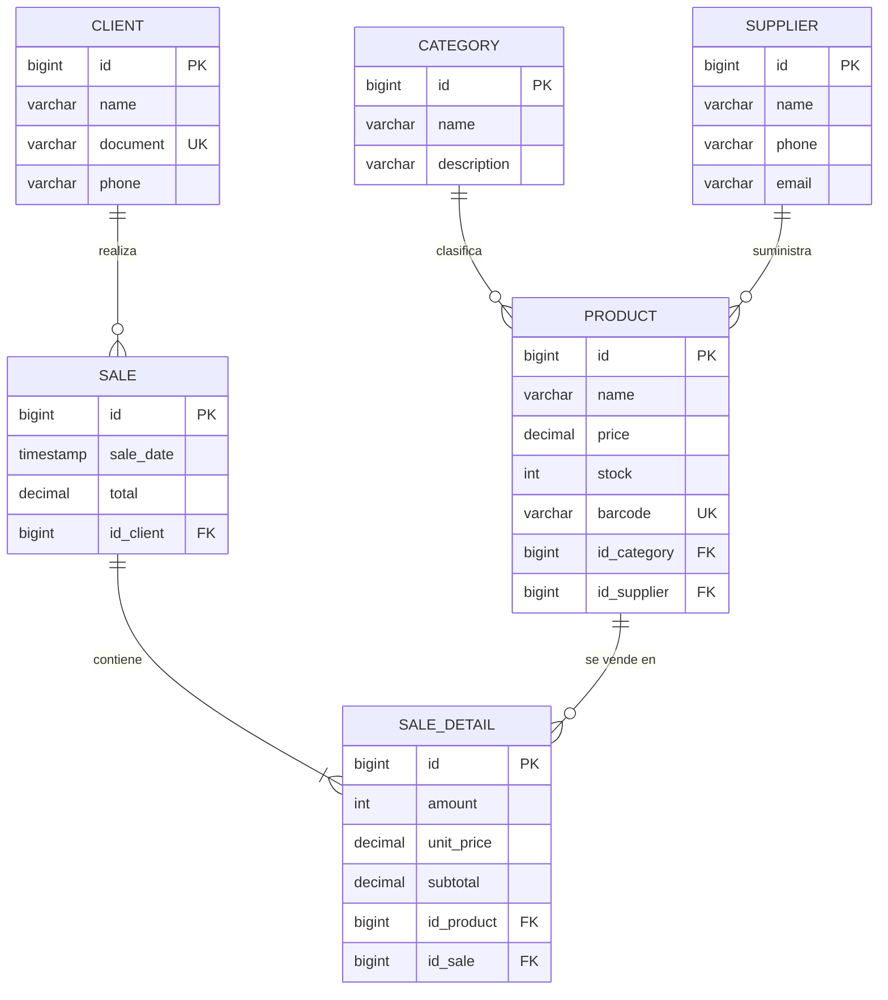

<div align="center">

# 🛒 Supermarket System

### API REST para la gestión de un supermercado


**Categorías · Proveedores · Clientes · Productos · Ventas**

</div>

---

## 📑 Contenido

- [✨ Qué hace el proyecto](#-qué-hace-el-proyecto)
- [🧰 Tecnologías](#-tecnologías)
- [🗂️ Estructura del proyecto](#️-estructura-del-proyecto)
- [🗃️ Modelo de datos](#️-modelo-de-datos)
- [✅ Requisitos previos](#-requisitos-previos)
- [🚀 Instalación y ejecución](#-instalación-y-ejecución)
- [📮 Colección de Postman](#-colección-de-postman)
- [🔗 Endpoints](#-endpoints)
- [🧠 Reglas de negocio](#-reglas-de-negocio)
- [🚦 Códigos de respuesta](#-códigos-de-respuesta)
- [🛠️ Solución de problemas](#️-solución-de-problemas)

---

## ✨ Qué hace el proyecto

Es el backend de un supermercado. Permite:

- 📂 Administrar **categorías** y 🚚 **proveedores**.
- 🧑 Registrar **clientes**.
- 📦 Controlar **productos** con precio, stock y código de barras.
- 🧾 Registrar **ventas** con varios productos en una sola petición. El sistema descuenta el stock y calcula el total solo.

---

## 🧰 Tecnologías

| Tecnología | Versión | Para qué se usa |
|---|---|---|
| ☕ Java | 21 | Lenguaje |
| 🍃 Spring Boot | 4.1.1 | Framework de la API |
| 🗄️ Spring Data JPA / Hibernate | — | Acceso a la base de datos |
| 🐘 PostgreSQL | — | Base de datos |
| 🧪 Lombok | — | Menos código repetido (getters y setters) |
| 📦 Maven Wrapper | — | Compilar y ejecutar sin instalar Maven |
| 📮 Postman | — | Probar los endpoints |

---

## 🗂️ Estructura del proyecto

```text
Supermarket_system/
├── 📁 Database/
│   └── db_supermarket.sql              ← script para crear las tablas
├── 📁 Postman/
│   └── Supermarket_API.postman_collection.json
├── 📁 backend/
│   ├── pom.xml
│   ├── mvnw / mvnw.cmd                 ← Maven Wrapper
│   └── src/main/
│       ├── java/com/supermarket/
│       │   ├── Category/    ┐
│       │   ├── Client/      │  cada carpeta tiene:
│       │   ├── Product/     │  controller · dto · entity
│       │   ├── Sale/        │  repository · service
│       │   ├── SaleDetail/  │
│       │   ├── Supplier/    ┘
│       │   └── SupermarketApplication.java
│       └── resources/
│           └── application.yaml        ← configuración (puerto y base de datos)
└── 📄 README.md
```

**Cómo fluye una petición:** `Controller` → `Service` → `Repository` → Base de datos.

---

## 🗃️ Modelo de datos



---

## ✅ Requisitos previos

Antes de empezar, instala:

| Herramienta | Versión | Verificar con |
|---|---|---|
| ☕ JDK | 21 o superior | `java -version` |
| 🐘 PostgreSQL | 14 o superior | `psql --version` |
| 📮 Postman | Última | — |
| 💻 VS Code (opcional) | Con *Extension Pack for Java* | — |

> 💡 No necesitas instalar Maven, el proyecto trae su propio Maven Wrapper (`mvnw`).

---

## 🚀 Instalación y ejecución

### 1️⃣ Descargar el proyecto

```bash
git clone <URL-DEL-REPOSITORIO>
cd Supermarket_system
```

### 2️⃣ Crear la base de datos

El proyecto usa `ddl-auto: none`, es decir, **Spring Boot no crea las tablas**. Hay que crearlas con el script.

**Opción A: desde la terminal (psql)**

```bash
# Crear la base de datos
psql -U postgres -c "CREATE DATABASE supermarket;"

# Crear las tablas
psql -U postgres -d supermarket -f Database/db_supermarket.sql
```

**Opción B: desde pgAdmin o DBeaver**

1. Clic derecho en **Databases** → **Create** → **Database** y escribe `supermarket`.
2. Abre una consola de consultas (*Query Tool*) sobre esa base de datos.
3. Abre el archivo `Database/db_supermarket.sql` y ejecútalo completo (**F5**).

✅ Al terminar deben existir 6 tablas: `category`, `supplier`, `client`, `product`, `sale` y `sale_detail`.

### 3️⃣ Configurar la conexión

Abre `backend/src/main/resources/application.yaml` y ajusta tu usuario y contraseña de PostgreSQL:

```yaml
spring:
  application:
    name: supermarket

  datasource:
    url: jdbc:postgresql://localhost:5432/supermarket
    username: postgres               # 👈 tu usuario
    password: TU_CONTRASEÑA          # 👈 tu contraseña
    driver-class-name: org.postgresql.Driver

  jpa:
    hibernate:
      ddl-auto: none
    show-sql: true

server:
  port: 6060                         # 👈 puerto de la API
```

### 4️⃣ Ejecutar el backend

**Desde la terminal**

```bash
cd backend

# Windows (PowerShell o CMD)
.\mvnw.cmd spring-boot:run

# Linux / macOS
./mvnw spring-boot:run
```

**Desde VS Code:** abre `SupermarketApplication.java` y presiona **▶ Run**.

### 5️⃣ Comprobar que funciona

Con la app corriendo, abre en el navegador:

```
http://localhost:6060/Category/Get
```

Si ves `[]` (lista vacía), todo salió bien. 🎉

---

## 📮 Colección de Postman

📁 Archivo: [`Postman/Supermarket_API.postman_collection.json`](Postman/Supermarket_API.postman_collection.json)

### Cómo importarla

1. Abre Postman → botón **Import**.
2. Arrastra el archivo `.json` (o elígelo con **Files**).
3. Verás la colección **Supermarket System - API REST** con 8 carpetas.

### Cómo usarla

Con el backend encendido, tienes dos opciones:

- ▶️ **Todo de una vez:** clic derecho en la colección → **Run collection** → **Run**.
- 👆 **Una por una:** sigue el orden de las carpetas.

| # | Carpeta | Qué contiene |
|---|---|---|
| 1 | 📂 Category | Crear, listar, consultar y actualizar |
| 2 | 🚚 Supplier | Crear, listar, consultar y actualizar |
| 3 | 🧑 Client | Crear, listar, consultar y actualizar |
| 4 | 📦 Product | Crear 2 productos, listar, consultar y actualizar |
| 5 | 🧾 Sale | Crear una venta, consultarla y verificar el stock |
| 6 | 🧩 SaleDetail | Crear, listar, consultar y actualizar detalles |
| 7 | ⚠️ Casos de error | Pruebas que deben fallar a propósito (400, 404 y 409) |
| 8 | 🧹 Eliminar | Borra los datos de prueba en el orden correcto |

### ✨ Lo que hace la colección por ti

- Guarda los ids que devuelve cada `POST` y los usa en las demás peticiones.
- Genera códigos de barras, documentos y correos únicos en cada ejecución, así que se puede correr varias veces.
- Trae **pruebas automáticas** que revisan el código de respuesta y los cálculos (por ejemplo, que el total sea 15000).

> 🌐 La variable `baseUrl` apunta a `http://localhost:6060`. Si cambias el puerto en `application.yaml`, cámbiala también en las variables de la colección.

---

## 🔗 Endpoints

Base URL: `http://localhost:6060`

| Recurso | ➕ Crear | 📋 Listar | 🔍 Por id | ✏️ Editar | 🗑️ Eliminar |
|---|---|---|---|---|---|
| **Category** | `POST /Category/Post` | `GET /Category/Get` | `GET /Category/Get/{id}` | `PUT /Category/Put/{id}` | `DELETE /Category/Delete/{id}` |
| **Supplier** | `POST /Supplier/Post` | `GET /Supplier/Get` | `GET /Supplier/Get/{id}` | `PUT /Supplier/Put/{id}` | `DELETE /Supplier/Delete/{id}` |
| **Client** | `POST /Client/Post` | `GET /Client/Get` | `GET /Client/Get/{id}` | `PUT /Client/Put/{id}` | `DELETE /Client/Delete/{id}` |
| **Product** | `POST /Product/Post` | `GET /Product/Get` | `GET /Product/Get/{id}` | `PUT /Product/Put/{id}` | `DELETE /Product/Delete/{id}` |
| **Sale** | `POST /Sale/Post` | `GET /Sale/Get` | `GET /Sale/Get/{id}` | — | `DELETE /Sale/Delete/{id}` |
| **SaleDetail** | `POST /SaleDetail/Post` | `GET /SaleDetail/Get` | `GET /SaleDetail/Get/{id}` | `PUT /SaleDetail/Put/{id}` | `DELETE /SaleDetail/Delete/{id}` |

Extra: `GET /SaleDetail/Get/sale/{saleId}` muestra los productos de una venta.

### 📝 Qué enviar en el cuerpo (JSON)

<details>
<summary><b>📂 Category</b></summary>

```json
{ "name": "Lácteos", "description": "Leche, queso y yogur" }
```
</details>

<details>
<summary><b>🚚 Supplier</b></summary>

```json
{ "name": "Alpina", "phone": "3101234567", "email": "ventas@alpina.com" }
```
</details>

<details>
<summary><b>🧑 Client</b></summary>

```json
{ "name": "Ana Pérez", "document": "1094123456", "phone": "3209876543" }
```
</details>

<details>
<summary><b>📦 Product</b></summary>

```json
{
  "name": "Leche 1L",
  "price": 4500.00,
  "stock": 20,
  "barcode": "7701234567890",
  "idCategory": 1,
  "idSupplier": 1
}
```
</details>

<details open>
<summary><b>🧾 Sale (venta completa)</b></summary>

```json
{
  "idClient": 1,
  "details": [
    { "idProduct": 1, "amount": 2 },
    { "idProduct": 2, "amount": 3 }
  ]
}
```

Con Leche a 4500 y Pan a 2000, `GET /Sale/Get/1` responde:

```json
{
  "id": 1,
  "saleDate": "2026-10-20T10:30:00",
  "total": 15000.00,
  "idClient": 1,
  "details": [
    { "id": 1, "amount": 2, "unitPrice": 4500.00, "subtotal": 9000.00, "idProduct": 1, "idSale": 1 },
    { "id": 2, "amount": 3, "unitPrice": 2000.00, "subtotal": 6000.00, "idProduct": 2, "idSale": 1 }
  ]
}
```
</details>

<details>
<summary><b>🧩 SaleDetail (detalle suelto)</b></summary>

```json
{ "amount": 2, "idProduct": 1, "idSale": 1 }
```
</details>

> 🔢 `phone` y `barcode` van **entre comillas** (son texto). `price`, `stock` y los ids van sin comillas.

---

## 🧠 Reglas de negocio

**🧾 Ventas**
- Al crear una venta se valida que el cliente exista, que haya productos, que las cantidades sean mayores a 0 y que alcance el stock.
- Se **descuenta el stock** de cada producto y se guarda el **precio del momento** (`unit_price`). Si el precio cambia después, la venta no se altera.
- El `subtotal` de cada detalle es `precio × cantidad`, y el `total` es la suma de los subtotales.
- Todo ocurre en **una sola transacción**: si algo falla (por ejemplo, stock insuficiente en el segundo producto), no se guarda nada y el stock queda como estaba.
- Al **eliminar una venta** se devuelve el stock a los productos y se borran sus detalles.

**🔒 Validaciones**
- El código de barras del producto es **único** y solo acepta números.
- El documento del cliente, el nombre de la categoría y el correo del proveedor no se pueden repetir.
- Precio mayor a 0 y stock mayor o igual a 0 (el stock puede quedar en 0 al vender la última unidad).
- No se puede eliminar una **categoría** ni un **proveedor** que tengan productos.

**⚠️ Para tener en cuenta**
- Los endpoints sueltos de `SaleDetail` (`POST`, `PUT`, `DELETE`) **no** descuentan stock ni actualizan el total de la venta. Para vender, usa `POST /Sale/Post`.
- Al editar (`PUT`) una categoría, un cliente o un proveedor, el nombre, documento o correo nuevo debe ser distinto a los que ya existen.

---

## 🚦 Códigos de respuesta

| Código | Significado | Ejemplo |
|---|---|---|
| ✅ `200 OK` | Consulta o actualización correcta | `GET /Product/Get` |
| 🆕 `201 Created` | Registro creado | `POST /Sale/Post` |
| 🗑️ `204 No Content` | Eliminado correctamente | `DELETE /Sale/Delete/1` |
| ❌ `400 Bad Request` | Datos inválidos o repetidos | Cantidad 0, código de barras repetido |
| 🔎 `404 Not Found` | No existe el registro | `GET /Product/Get/999999` |
| ⛔ `409 Conflict` | Choca con una regla del negocio | Stock insuficiente, categoría con productos |

---

## 🛠️ Solución de problemas

<details>
<summary><b>❌ <code>password authentication failed for user "postgres"</code></b></summary>

La contraseña de `application.yaml` no coincide con la de tu PostgreSQL. Corrígela y vuelve a ejecutar.
</details>

<details>
<summary><b>❌ <code>database "supermarket" does not exist</code></b></summary>

Falta crear la base de datos. Haz el [paso 2](#2️⃣-crear-la-base-de-datos).
</details>

<details>
<summary><b>❌ <code>relation "category" does not exist</code></b></summary>

La base existe pero no tiene tablas. Ejecuta `Database/db_supermarket.sql` conectado a `supermarket`.
</details>

<details>
<summary><b>❌ <code>Port 6060 was already in use</code></b></summary>

Hay otra aplicación usando ese puerto. Ciérrala o cambia `server.port` en `application.yaml` (y la variable `baseUrl` en Postman).
</details>

<details>
<summary><b>❌ Postman responde <code>Could not send request</code></b></summary>

El backend no está encendido, o `baseUrl` apunta a otro puerto. Revisa la consola de Spring Boot.
</details>

<details>
<summary><b>❌ VS Code marca error en los getters y setters</b></summary>

Es Lombok. Instala *Extension Pack for Java*, y luego ejecuta **Java: Clean Java Language Server Workspace** desde la paleta de comandos (`Ctrl + Shift + P`).
</details>

<details>
<summary><b>🔄 Quiero borrar todo y empezar de cero</b></summary>

En `Database/db_supermarket.sql` descomenta las líneas `DROP TABLE` y ejecuta el script completo. Ojo: se pierden todos los datos.
</details>

---

<div align="center">

📚 Proyecto académico · Análisis y Desarrollo de Software (ADSO) · SENA

Hecho con ☕ y mucho Spring Boot

</div>
